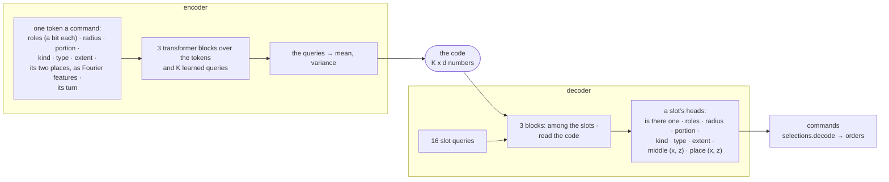
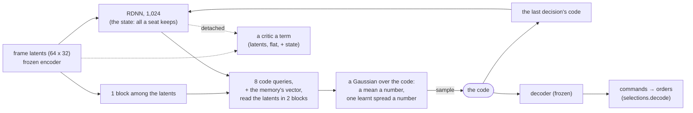

# The order autoencoder, and the actor that chooses its code

The user's, 2026-11-19, after `rdnn-5`'s checks: "I think a transformer-based autoencoder for a frame's orders (for one
side) would show improvements and simplify the RL training process given that its parameters are frozen when training
the policy; proceed with documenting the proposed architecture."  And later that day, with selections before commands
(06-select-then-command.md):

* "The orders autoencoder shouldn't have access to the frame's latent tokens (risk of representation collapse)."
* "Rather than selecting or positional orders based on region, consider a spatial encoding or finer subregions."
* "Go straight to the autoencoder and remove unit cross-attention from the policy."
* "The training data for the autoencoder should also include randomly/synthetically generated actions to ensure
  coverage of cases/orders not seen in the script."

And that afternoon, to what the first two trained had shown ("How it got here", below): "1. vae-2 2. bigger code should
be fine 3. either is fine 4. commands should be plausible/valid".  That is: the second one's stronger pull to the
Gaussian and few emptied decisions; a code bigger than 64 numbers, for the decisions that didn't fit; the actor
starting from the unit Gaussian or from the scripts' codes, either; and made-up commands that some unit could obey.

**Built**: the commands it encodes (06), the recorder of its data (`tools/order_data.py`), the autoencoder and its
training (`tools/order_vae.py`), its checks by play (`results/checks/language_check.py`), the actor that chooses its
code (`tools/policy_code.py`, `policy_train.py --size code`) and the trainer's path for it.  **Not done**: a run, which
is on the user's word (`results/start-code.sh HOURS`; `results/launch-code.sh` has the flags).

The autoencoder, that it's frozen, that it reads no frame, places as coordinates, made-up data that's plausible, the
pull and the bigger code, and a policy that reads no unit are the user's.  Every size, loss, share and rule below is
mine, the code's 128 numbers among them.

## The idea

A side's orders at a decision are a few commands, each a selection and one thing told to it (06).  Nothing in a command
points into a frame.  So the commands of a decision can be autoencoded on their own: a small **code** in, the same
commands out.  Trained once, then frozen.  The policy chooses a code a decision and nothing else; the decoder says the
commands, and `selections.decode` carries them out on the frame.

| Seen in `rdnn-5` (docs/training_logs.md, "The checks after it") | With a code |
|---|---|
| Under one action a decision, to a unit picked without regard to whether it's idle; 71% of fighter-time idle | A command tells every unit of its roles in its circle |
| Eleven heads, each with its entropy, its floor and its start | One distribution, over the code |
| The learner featurizes every frame it trains on (about 700 tokens) | The update reads the frame's 64 latents, the memory's state and the code |

## The autoencoder (`tools/order_vae.py`)

* **It reads commands and nothing else**: no frame latents, no unit tokens, no map.  So the decoder can't give the
  commands back by reading the frame and ignoring the code, which is the collapse the user named.
* **A place is two numbers**, fractions of the map.  In, each goes as itself and its sine and cosine at 8 octaves
  (periods from the whole map down to 1/128 of it); out, a sigmoid.  No region and no grid.
* **The code**: K 8 tokens of d 16, 128 numbers.  A mean and a variance each, sampled in training, with a pull towards
  a unit Gaussian (`--beta` 0.1): the policy has to produce codes, not only read them, so codes near one another should
  say decisions near one another.  4 tokens held the scripts' decisions of up to 4 commands; 8 hold those of up to 8,
  and the scripts play as well through them as in commands; 16, trained as long, held less ("How it got here").
* **The slots are in the commands' turn**: slot i says command i.  The turn means something (a unit that obeyed is in no
  later selection), and it's what keeps this from being a matching problem.  The decision ends at the first slot that
  says there's no command.
* **Played, it doesn't sample**: every head's likeliest.  All the chance in a decision is in the code.
* **What it says is plausible** (the user: "commands should be plausible/valid"; `OrderVAE.say`, `selections.able`).
  By the type table alone, a role can be told a kind if some type of the role ever can (a PRODUCE: the factories and
  the static builders; a BUILD, an ASSIST, a RECLAIM or an area mex: the builders; a jump: the roles with a jumper),
  and a role can make a type if one of its types builds or produces it.  Of the roles a slot's head gives, only those
  that can be told the kind said are kept, and the likeliest of them if none is likely; the type is the likeliest that
  a role said can make.  So no code says "fighters, produce" or "builder, build a raider".  Whether a unit can obey
  now (it's there, it's free, the place is in reach) is still the frame's to say when the command is carried out.
  All 60,738 of the scripts' held-out commands looked at are plausible by this, so nothing of theirs is cut.
* **The loss**: for each slot whether there's a command; for each command the cross-entropy of its radius, portion and
  kind, of each role's bit, and of the type and extent where its kind has one; 100 times the distance of each place
  (a nat for 1% of the map); and beta times the pull to the Gaussian.
* **Width 192, 3 blocks each way, 4 heads**: 3,283,489 parameters.  In training the two transformers run in half
  precision; what they give is read in float32, and so is all of it in play.

## Its data

**The scripts' commands** (`tools/order_data.py`, `results/order-data.sh`):

* **Games played in the commands' own terms**: every team is a seat the scripts only advise, and what's carried out is
  their advice said as commands and read back (`SimEnv.through`).  Each look's commands are kept, with the map's size.
  The kinds of game are the training's (1v1s, teams, free-for-alls, chicken), on the pool's training maps.
* **No frame is kept**: a decision is its commands, 28 bytes each.
* **`/mnt/d/zk-learned/orders/commands-1`** (2026-11-19; 68 MB, recorded in 19 minutes on 8 processes): 1,500,022
  decisions of 1,381 games that ended and those under way, 5,564,234 commands, 3.7 a decision.  The last of its 8 parts
  is held out.
* **What it lost of the scripts' 24.1M orders**, in games of every kind, where the armies are bigger than in the 1v1s of
  06's check: a third of the commands were past the 16 a decision (2.71M of 8.27M); 21% of the orders were to units
  that aren't among those the side's frame gives it to command (the featurizer's 512); 3% found no command of their own
  (ASSIST, nearly all).

**Made up** (the user; `order_vae.made_up`, `synthetic`, `spliced`; `--synthetic` 0.3, the share of training's decisions
that aren't the scripts' own):

* **A made-up command is plausible** (the user, 2026-11-19, of the first two autoencoders, whose made-up commands had
  any roles and any type: "commands should be plausible/valid").  Its kind is any of the 21 alike.  Its roles are among
  those that can be told the kind (`selections.able`, as above): one of them half the time, and else that one with each
  other of them at three in ten.  Its type, where its kind has one, is any that the first of its roles can build or
  make.  Its radius is any alike, with the nearest half or quarter two times in five; its extent and its two places
  any alike, where its kind has them.
* **Half of the share are decisions wholly made up**: 1 to 16 such commands, three in ten any number alike and the rest
  few (2.5 on average), as the scripts' are.
* **Half are the scripts' decisions with three in ten of their commands swapped** for made-up ones, each in its own
  slot: a script's decision but for a command no script gave.
* **A fiftieth of training's decisions are emptied** (`--empty` 0.02): a look where the scripts say nothing isn't kept,
  and a code should be able to say nothing.  With a tenth emptied, as the first one had, saying nothing took up the
  middle of the code space.

## What it gives back

`/mnt/d/zk-learned/orders/vae-3` (2026-11-19: 16,000 steps of 2,048 decisions, 32 minutes; its `summary.json`, and
`results/order-vae-eval.sh` for the tables after the first).  Each decision goes to its code's mean and back:

| | The scripts' own, held out | With three in ten swapped | Made up, 4 commands or fewer | Made up, 1 to 16 |
|---|---|---|---|---|
| The count of commands right | 100% | 100% | 100% | 100% |
| Kind | 99.0% | 94.1% | 97.1% | 76.5% |
| Roles, all 19 bits | 96.3% | 88.3% | 81.9% | 67.6% |
| Radius | 95.6% | 90.6% | 99.5% | 71.8% |
| Portion | 97.8% | 96.5% | 99.7% | 90.4% |
| Type, where there's one | 95.7% | 90.8% | 94.5% | 64.6% |
| Extent, where there's one | 100% | 92.4% | 100% | 75.4% |
| The circle's middle off by, median (90th), elmos | 11 (64) | 15 (102) | 19 (47) | 29 (662) |
| The command's place off by | 10 (32) | 14 (78) | 21 (52) | 31 (652) |
| Commands right in everything, places within 100 elmos | 86.7% | 78.0% | 78.3% | 52.7% |
| Decisions right in everything | 89.3% | 75.9% | 63.6% | 46.6% |

* **The scripts' decisions come back**: nine in ten whole, a place within 11 elmos.  Which nine, below.
* **What no script gave comes back too**, now that it's plausible: a made-up decision of a few commands whole two times
  in three, its sets of roles 82% of the time and its types 95%.  From the two autoencoders whose made-up commands had
  any roles and any type, those came back 6 to 18% and 22 to 39% of the time: a plausible command names one of the few
  sets of roles its kind is for.
* **Sixteen made-up commands** come back whole about half the time.

**By how many commands a decision has** (the scripts' own, held out):

| Commands | 1 | 2 to 4 | 5 to 8 | 9 to 15 | 16 |
|---|---|---|---|---|---|
| Of the decisions | 30% | 46% | 14% | 5% | 5% |
| Kind | 100% | 100% | 100% | 96.1% | 98.4% |
| Roles | 99.9% | 99.8% | 99.6% | 91.0% | 89.5% |
| Type, where there's one | 100% | 100% | 99.9% | 71.9% | 58.8% |
| The circle's middle off by, median, elmos | 6 | 8 | 10 | 25 | 29 |
| Commands right in everything | 99.6% | 99.6% | 99.2% | 66.5% | 62.0% |
| Decisions right in everything | 99.6% | 98.8% | 95.6% | 5.6% | 4.8% |
| Nats from the unit Gaussian | 28 | 75 | 178 | 288 | 300 |

**The code holds a decision of up to eight commands, nearly to the elmo.**  The tenth of the scripts' decisions with
nine or more are their armies told unit by unit, and those come back with a third of their commands wrong somewhere.
Played, that costs nothing that 128 games show ("The checks by play").

**How wide the codes lie**: a number of a code's mean is 0.46 wide over the held-out decisions, the encoder's own spread
round it 0.74 on average, and a code is 97 nats from the unit Gaussian.  Most of a short decision's code is left at the
Gaussian.

**What a code says when it's off** (the held-out scripts' decisions; a unit Gaussian's draw times the spread added to
each code): this is what a policy says whose mean is the decision and whose spread is that much.

| Spread | 0 | 0.03 | 0.1 | 0.3 | 1 |
|---|---|---|---|---|---|
| The count of commands right | 100% | 100% | 99.9% | 94.2% | 52.0% |
| Kind | 99.0% | 99.0% | 98.9% | 97.5% | 65.7% |
| Roles | 96.3% | 96.3% | 96.0% | 93.6% | 51.4% |
| Type | 95.7% | 95.6% | 95.3% | 89.8% | 23.5% |
| The circle's middle off by, median, elmos | 11 | 74 | 230 | 674 | 2,022 |
| The command's place off by | 10 | 68 | 219 | 650 | 1,988 |

**What codes drawn round zero say** (20,000 a spread):

| Spread | 0.1 | 0.3 | 0.5 | 0.75 | 1 |
|---|---|---|---|---|---|
| Nothing | 0% | 0% | 0% | 0.2% | 1.5% |
| Commands a decision | 2.0 | 1.9 | 1.8 | 1.8 | 1.7 |

At a spread of 1, of the commands said: FIGHT 46%, ASSIST 12%, PRODUCE 10%, MOVE 8%, BUILD 7%; half select one unit.
At 0.1 it's two FIGHTs.

* **What a command is survives a policy's spread**: at 0.3, the kinds 97.5% of the time, the sets of roles 94% and the
  types 90%.  At 1, where the actor starts, a code says another decision.
* **Where it is doesn't.**  A place is off by 220 to 230 elmos at a spread of 0.1 and by 650 at 0.3, and so it was from
  every autoencoder trained, whatever its pull or its size (150 to 230 at 0.1).  At 0.03 it's 70.  So the actor's least
  spread falls from 0.1 to 0.03 as a run goes on (the user; "The actor").
* **Zero says something**: two FIGHTs.  An untrained actor says 1.7 commands a decision, all plausible.

## How it got here

Four were trained on 2026-11-19, each 16,000 steps on `commands-1`.  The user chose after the first two: "vae-2",
"bigger code should be fine", "commands should be plausible/valid".

| | `vae-1` | `vae-2` | `vae-3`, the one in use | `vae-4` |
|---|---|---|---|---|
| The code | 4 x 16 | 4 x 16 | 8 x 16 | 16 x 16 |
| The pull; decisions emptied | 0.01; a tenth | 0.1; a fiftieth | 0.1; a fiftieth | 0.1; a fiftieth |
| A made-up command | any roles and type | any roles and type | plausible | plausible |
| **The scripts' own, held out**: decisions right in everything | 77.0% | 74.7% | 89.3% | 79.4% |
| kind, roles, type | 97.0%, 88.0%, 87.2% | 96.5%, 86.6%, 86.2% | 99.0%, 96.3%, 95.7% | 96.8%, 90.5%, 87.6% |
| decisions of 5 to 8 commands right in everything | 18.4% | not measured | 95.6% | 30.9% |
| of 9 or more | 1 to 3% | not measured | 5% | 0.5 to 3% |
| **Made up, 4 commands or fewer**: roles, type | 17.6%, 39.3% | 6.0%, 21.8% | 81.9%, 94.5% | 79.9%, 85.5% |
| **Nats from the unit Gaussian** | 174 | 86 | 97 | 86 |
| the encoder's own spread | 0.34 | 0.57 | 0.74 | 0.88 |
| **Codes drawn round zero at a spread of 1**: say nothing | 72% | 5% | 1.5% | 4.3% |
| commands a decision | 0.46 | 1.92 | 1.74 | 1.79 |
| **A code off by 0.3**: kind, roles, type right | 83%, 62%, 46% | 93%, 79%, 75% | 97.5%, 94%, 90% | 92%, 85%, 74% |
| its places off by, elmos | 430 to 450 | 610 to 650 | 650 to 675 | 600 to 650 |
| **The scripts through its code**: won, lost, drew of 128 | 32, 89, 7 | not played | 60, 62, 6 | not played |

* **The pull and the emptied share** (`vae-1` to `vae-2`): with a tenth of decisions emptied and a small pull, zero and
  most of what's near it said nothing, and a code off by 0.3 lost its kinds.  With the stronger pull the scripts'
  decisions come back nearly as well from half the nats.
* **Twice the code, and made-up commands that are plausible** (`vae-2` to `vae-3`): decisions of up to 8 commands fit
  where those of up to 4 did, and what no script gave comes back.  Both changed at once; the made-up rows are the
  plausibility's, the rows by length the code's.
* **Four times the code** (`vae-4`), trained as long, gave back less than twice: it left more of its code at the
  Gaussian and held decisions of up to 4.  Why wasn't looked into (longer, or a weaker pull, might use it): 128 numbers
  play level, so 256 weren't pursued.

## The checks by play

`results/checks/language_check.py`, 128 1v1s each, team 0 a seat the scripts only advise and team 1 the scripts as they
are (06, "The check", has the first two rows).

| | Team 0 won, lost, drew | Its games' result | The tests' score |
|---|---|---|---|
| The advice as it is (06) | 67, 57, 4 | 0.539 ± 0.044 | not kept |
| As commands and back (06) | 62, 64, 2 | 0.492 ± 0.044 | not kept |
| As commands, to their code's mean (`vae-3`), and back | 60, 62, 6 | 0.492 ± 0.044 | 0.495 ± 0.028 |
| The same through `vae-1`'s 64 numbers | 32, 89, 7 | 0.277 ± 0.044 | 0.361 ± 0.025 |
| A code drawn from the unit Gaussian at each look (`vae-1`), and what it says | 1, 126, 1 | 0.012 ± 0.044 | 0.165 ± 0.007 |

* **Through `vae-3`'s code the scripts play as they do in commands**: 60 won and 62 lost, for 62 and 64.  So a policy
  that meant exactly the scripts' decisions would play as the scripts do through this decoder, within what 128 games
  show.  Not everything is the same on the way: of the units the scripts told something at a look, 38% were told the
  same by what the code said, where commands alone told 71%; and 7% of looks had 20 commands or more, where 3% had (an
  army not told what the script meant is told again at the next look).  What differs is in the long looks, and it
  didn't cost games.
* **Through `vae-1`'s 64 numbers they lost half their wins**: 29% of the units told the same.  That was the decisions
  of five commands and more.
* **Codes drawn at random hardly play** (`vae-1`): 1 win of 128 and a score of 0.165, beside 0.144 to 0.151 at
  iteration 0 of the runs from nothing (their tests are other games of the same kind, so roughly beside).  Those codes
  said nothing 72% of the time, and their 88,681 commands gave 12,656 orders.  Not played again with `vae-3`: its
  random codes say four times the commands, all plausible, and in the trainer's smoke below an untrained actor's 1.9
  commands a decision told 0.55 units (0.45 on `vae-2`, before the commands were plausible).  Most of what keeps a
  command from being obeyed is the frame's: no unit of those roles yet, or none free.

## The actor (`tools/policy_code.py`; `policy_train.py --size code`)

* **No unit is read** (the user: "remove unit cross-attention from the policy").  The actor is the frozen frame encoder,
  the memory as `--size rdnn` has it, and a code head.  The anchor, the plan, every head and the action tokens are
  gone.  What the memory is told of the last decision is its code.  6,414,992 trained parameters (`rdnn`: 9,871,219),
  2,625,536 of them the RDNN.
* **It starts as the unit Gaussian**: the mean's last layer is zero and the spread 1.  So an untrained policy plays the
  last of the checks above, whatever the frame.
* **The spread** is one number for each of the code's 128, the same at every decision, 1 at first and never wider: the
  Gaussian the autoencoder was pulled towards (`LOG_STD_MOST`).  Under GRPO it has no entropy bonus, as the old heads
  had none, so what holds it up is its least.
* **Its least falls as a run goes on** (the user, 2026-11-19, told that a place is 220 elmos off at a spread of 0.1 and
  70 at 0.03: "Start with 0.1, decreasing to 0.03 as the training run continues").  `--spread-floor ITERATION:SPREAD
  ...` gives it by iteration, linear between its points and the last after, as the trainer's other ramps; the default
  is 0.1 throughout.  `results/start-code.sh HOURS` writes `0:0.1 N:0.03` for the run, N its hours at 350 iterations
  an hour (mine: the smoke's 2,000 decisions a second, less its tests): 8,400 for 24 hours.  It's a buffer of the
  actor's (`CodeActor.log_std_least`), which the learner sets each iteration (`Learner.set_floor`) for itself and for
  the average of its weights that plays the tests; the collectors get it with the weights, and a checkpoint keeps it.
  A spread under its least is read as the least and still learns its way back.  `code_spread_floor` in a run's
  metrics.
* **The update** (`Learner._loss_code`) reads, of a decision, the frame's latents as it was played with, the memory's
  state and the code drawn.  It featurizes no frame and doesn't run the decoder: a code's probability has nothing to do
  with what it says.  A decision is one action with one probability; Simple Policy Optimization, the advantages, the
  KL the rate follows (estimated from the codes drawn, as it was from the actions) and the critics are as they were.
* **In play** (`Player._forward`, `policy_graphs.Graphs._head_code`) the frame is still featurized: the encoder reads
  it, and `selections.decode` reads the units' places, roles and masks to carry the commands out.  A pass is one CUDA
  graph: the decision, the code drawn, what the decoder says of it, what's kept.
* **A step is stored** with its code and the code's probability, its action fields empty (`Step.code`).
  `actions_a_decision` in a run's metrics is then its commands, `orders_a_decision` the units they told, and
  `share_kind{k}` is by command; `code_spread`, `code_spread_min` and `code_mean_abs` say where the Gaussian is.
* **It needs** GRPO (`--group`) and the memory's critics (`--critic-size memory`) or none; no cloning loss and no clone
  to stay near.  The autoencoder's file is the size's (`policy_latent.ORDER_CODER`) or `--order-coder`, and its
  weights are in each checkpoint with the path.
* **Tests** (`tests/policy/test_code_actor.py`): played through the trainer's own path and learnt from, each code as
  likely in training as when it was drawn and no frame featurized; and its pass as a CUDA graph against the same eagerly.

| | The actor till now | With the code |
|---|---|---|
| A decision's probability | the product of its actions', each a unit and then its order's choices | one Gaussian's |
| Entropy | eleven heads, each with a coefficient and a floor (`adjust_entropy`) | one spread a number, within bounds |
| What the learner reads of a decision | the frame's tokens, about 700 | 64 latent tokens |
| What the memory is told was done | the actions' vectors, averaged | the code |
| Trained parameters | 9.9M | 6.4M |

The critics, the reward's terms, GRPO's groups and branches, the objective a seat is told and the memory stay.

**A smoke of the trainer** (`results/smoke-code.sh 3`, 2026-11-19, on `vae-3`: `launch-code.sh`'s flags, so `rdnn-5`'s
two collectors of 48 games on the pool, into a scratch directory):

* **It runs**: three iterations of 16,384 decisions in 78 s, the start included, with no error and nothing chosen
  outside its mask.
* **About four times `rdnn-5`'s rate**: 2,020 to 2,120 decisions a second overall in the second and third iterations
  (collecting at 1,800 to 1,920, training at 3,280 to 5,120), where `rdnn-5` made 13.2M in 7 hours, 520 a second.  A
  pass has no actions to step through and the update no frame to featurize.
* **Little of the card**: the learner held 1.34 GB and a collector 0.27 to 0.31 of its 2.0.  A minibatch was about 515
  decisions.
* **Play and training agree on a code's probability** through the collectors' graphs: with the actor waiting out the
  critics' first 10 iterations, the KL and every ratio's distance from 1 were 0.
* **Untrained** it said 1.7 to 2.1 commands a decision, and 0.5 to 0.6 units a decision obeyed one: FIGHT 46% of the
  commands, ASSIST 12%, PRODUCE 10%, MOVE 8%, BUILD 7%, ATTACK_UNIT and RECLAIM 3% each, the rest about 1% each.

Three iterations say nothing of whether it learns.

## What it can't do, and what may go wrong

* **A code's places are blind to the frame.**  A code says a place whatever is there.  What makes that playable is in
  how a command is carried out: the nearest unit of the roles is selected, an extractor goes to the free spot nearest
  the place, a target is whoever's nearest.  The policy has to learn where things are from the latents and say it as a
  place through a frozen decoder.
* **A place is only as near as the spread lets it be**: 650 elmos off at 0.3, 220 at 0.1, 70 at 0.03 ("What it gives
  back"), and the least spread is 0.1 at a run's start and 0.03 at its end.  A FIGHT or a build survives 220, an
  extractor goes to the nearest free spot; the middle of a small circle, and "the nearest one", may pick another unit.
* **The policy sees the frame only through the frozen encoder**, which kept less of the policy's own scattered army than
  of the scripts' (the log, "The frozen encoder on the policy's own frames").  Before, the choice of unit read each
  unit's raw features through layers RL trained.
* **A change of code changes many orders at once**, with one advantage a branch to say which of the 128 numbers helped.
* **Every decision retells everyone it reaches**: a code drawn anew each 3 s gives new commands, where the old actor
  mostly kept.  A build sticks whatever is said (02-policy.md), a fighter's march doesn't.
* **The scripts' longest decisions don't come back whole**: those of nine commands and more, a tenth of them.
* **Plausible isn't obeyed.**  A command's roles and type go with its kind by the type table; whether the side has
  such a unit, free and in reach, is the frame's, and an untrained actor's commands mostly find none.
* **Frozen**: if the commands turn out too narrow, a new autoencoder means codes mean something new, and a policy that
  chose codes is lost with it.

## Decided, and what's open

The user, 2026-11-19, to the five things put to them after `vae-1` and `vae-2`: "1. vae-2 2. bigger code should be fine
3. either is fine 4. commands should be plausible/valid".

1. **Which autoencoder**: `vae-2`'s settings.  `vae-3` has them.
2. **Long decisions**: a bigger code.  128 numbers (mine: twice; four times, trained as long, was worse).
3. **Where the policy starts**: either.  The unit Gaussian, as built; cloning the code of what the script advised
   isn't built.
4. **What's made up**: plausible commands, and so is everything the decoder says ("The autoencoder", "Its data").

And of the spread's least, put to them after `vae-3` (a place is 220 elmos off at 0.1, 68 at 0.03; a lower least lets
a policy mean a place, and lets it stop trying things): "Start with 0.1, decreasing to 0.03 as the training run
continues."  Built ("The actor"); that it falls by iteration, evenly, and over 350 iterations an hour of the run is
mine.

Open:

1. **A run**: `results/start-code.sh HOURS` (`launch-code.sh` is `rdnn-5`'s flags with `--size code`), with
   `code-status.sh`, `stop-code.sh`, `resume-code.sh` and the watchdog as the `rdnn` runs had.

## Order of work

1. ~~The commands, and the scripts' orders as commands~~ (06).
2. ~~The recorder, the autoencoder and its checks~~.
3. ~~The actor with a code head, the trainer's update for it, and play through the decoder~~.
4. ~~The user's choices after the first two autoencoders: `vae-3`~~.
5. A run, on the user's word.
6. The decoder and `selections.decode` in the bot's C++ (02-policy.md, "Deployment").

## Where the idea is from

Not looked up again, from memory: a policy that acts in a latent space learnt from recorded behaviour, with the decoder
frozen, is PLAS (Zhou et al., 2020) for single actions and SPiRL (Pertsch et al., 2020) and OPAL (Ajay et al., 2021)
for stretches of them.  04-literature.md has none of them yet.
