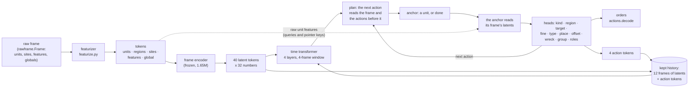
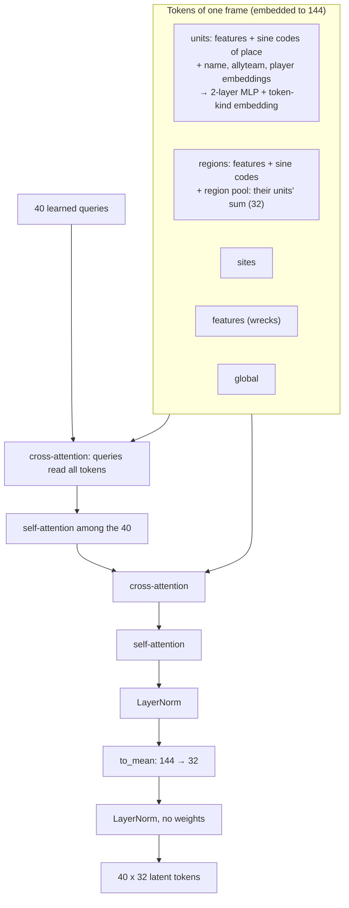
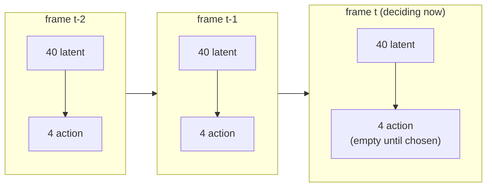
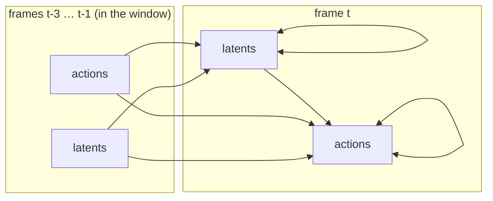
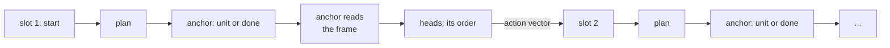
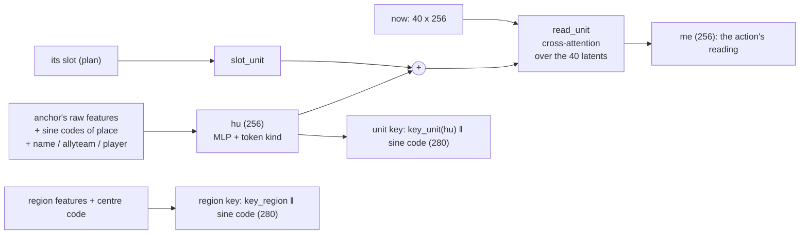
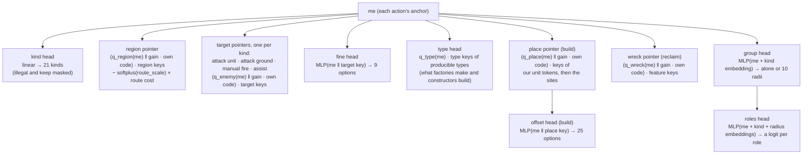
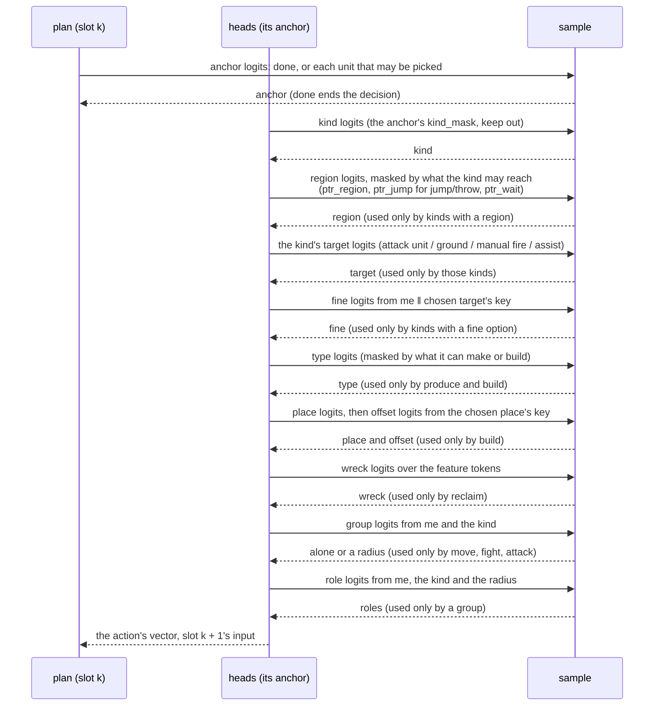
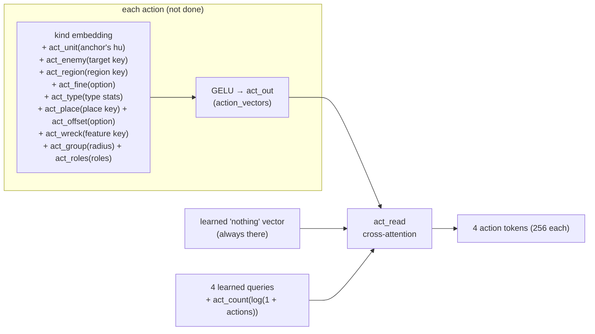
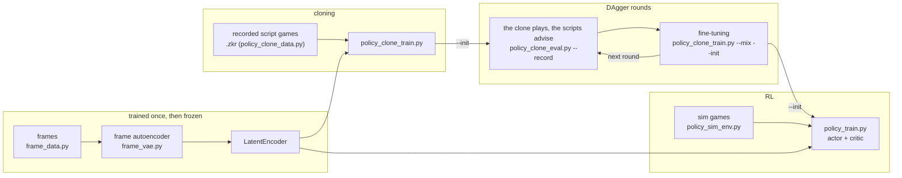

# The policy model

How the learned policy works: what it reads, how it reads it, and how it chooses orders.  The code:

* `tools/policy_latent.py`: the actor;
* `tools/frame_vae.py` and `tools/frame_model.py`: the frozen frame encoder;
* `tools/policy_model.py`: batches, sampling and the critic;
* `bots/zkbot/policy/featurize.py`: raw frame to tensors.

The observations and actions are specified in `docs/learned-policy/02-policy.md`, and training and its results in
`docs/learned-policy/03-training.md`.

## The whole of it

A decision is made every 90 game frames (3 s): `decide_every` 6 of the sim's 15-frame slots.  That's when the army script, which
the actor is cloned from, looks.  The actor reads only the frames it decides at.

1. The seat's raw frame becomes tokens.
2. A frozen encoder squeezes them into 40 latent tokens.
3. The actor reads those latents with the latents and actions of the frames before, over a sliding window in time.
4. It gives its orders as a player does: one action after another, up to 16, until it chooses done.  Each action picks a unit,
   its anchor.  The anchor reads the frame, and the heads choose its order.  That order may go as a group order to the units
   around it.
5. Units no action picks keep what they're doing.  What was done is summarised into 4 action tokens, which later frames read.

| | |
|---|---|
| Size | `policy_latent.SIZE`, kept in each checkpoint: width `d` 256, 8 heads, 4 time layers, 4 plan layers.  `SMALL` is 128, 4 heads, 2 and 2 |
| Parameters | 10,546,864 trained (`SMALL`: 1,929,088), and 1,650,816 frozen in the encoder at `encoder-big`'s recipe |
| Latent tokens a frame | 40, of 32 numbers each, LayerNormed without weights |
| Action tokens a frame | 4 (`ACTION_TOKENS`) |
| Decisions | every 3 s (`decide_every` 6; `window_frames` and `SimEnv(decide_every=)` take it) |
| Window | 4 frames, the frame itself included: `WINDOW_SECONDS` 8 at a decision every 3 s, rounded (9 s back) |
| Reach | 12 frames: each of the 4 layers reaches 3 further back, so a decision depends on the 12 before it (36 s) |
| Actions a decision | up to 16 (`actions.SLOTS`), then done |
| Who owns a unit | an allyteam and a player numbered from the viewer, in tables of 8 and 64 (`featurize.MAX_ALLY_TEAMS`, `MAX_PLAYERS`), 8 numbers each |
| Critic (PPO) | width 256, 4 layers of 8 heads: 3,221,865 parameters (3,234,715 with 51 bins); with `--critic-bins`, its value is a distribution trained by HL-Gauss |
| Strategy z | 32 numbers a side, optional (`--z` in cloning; `Z_DIM`): see "Frames in time" |

## What it reads: the featurizer

`featurize.featurize(frame, bundle, table)` turns a raw frame into fixed-normalisation numpy tensors (02-policy.md, "The
featurizer").  Tokens come in a fixed order:

    controllable units | every other unit, most important first | summaries | regions | sites | features | global

* **Units**: up to 592, of which up to 256 are controllable, plus 12 summaries of what the caps left out.  Each has 127 numbers:
  * type stats from the type table;
  * instance state: place, velocity, health, build, flags;
  * its current order and the order's age;
  * 24 terrain rays;
  * summary counts.
  
  Each unit also has a type name, an allyteam and a player, numbered from the viewer.  Its token kind says what is known of it:
  seen, blip, memory or summary.
* **Regions** (about 120 at most): 34 numbers each.  The first 27 are static (place, terrain, spots).  The rest say what is there
  now: own value, seen and radar enemy value, DPS, wreck metal, and so on.
* **Sites** (metal spots, up to 24): 9 numbers.
* **Features** (wrecks in sight, up to 32): 5 numbers.
* **Global**: 16 numbers (resources, storage, commander, time since contact, ...).
* **Masks for the heads**:
  * which tokens are controllable;
  * which kinds each may choose (`kind_mask`);
  * which targets each pointer kind may aim at;
  * which regions each unit may move, jump or wait to;
  * what each factory may produce and each constructor build;
  * a route cost to every region.
* **For the critic only**: enemy units the seat can't see (`hidden_*`, up to 64).

Names are dropped per game for the actor (`NAME_DROPOUT`: 30% of the vocabulary becomes "unknown"), so it learns to go by stats
too.  The frozen encoder always sees the true names.

## The frame encoder (frozen)

A Perceiver-style reader, trained on its own as an autoencoder (`frame_vae.py`), then frozen.  The recipe is `encoder-big`'s
(03-training.md, "The frame encoder"): width 144, 3 rounds, 40 queries.  Its decoder is thrown away, and the actor keeps
`LatentEncoder`: the encoder, `to_mean` and a weightless LayerNorm.

(Two of the three rounds are drawn.)

* **Cost** grows with tokens × 40, not tokens squared: there's no self-attention over the tokens themselves (`token_layers` 0).
* **Region tokens** carry what their units sum to (`region_pool`, squashed by asinh), since attention averages and can't count.
* **What taught the latent**: a decoder asked each region what's in it now (value by side and class), and the globals.  It also
  asked questions about a few units and wrecks a frame: "where is a unit like this?" and "what's at this exact place?".
  Terrain isn't asked: the actor knows the map.

## Frames in time: the actor's sequence

The actor lays frames out in order, as GPT-2 lays out text, each frame's 40 latent tokens followed by its 4 action tokens:

* **Inputs**: a latent token's is `latent_in(latents) + slots[i]` (which of the 40 it is).  An action token's is the frame's
  action summary + `act_slots[j]`.
* **Before the game**: frames from before it began are learned embeddings (`before`, `act_before`), so every decision sees a full
  reach.
* **A strategy, z** (optional): 32 numbers for the side, added through `z_in` to every token of every frame.
  * Two flags say what's known.  Then come the army script's role weights and knobs, its preset, and in hindsight the side's
    extractors, energy, factories, defences and army at minutes 3, 6 and 10 (`policy_clone_data.Z_*`).
  * `z_in` starts at zero, so a z changes nothing until it's learned.
  * An unknown z (zeros) is trained for by dropping it in a share of samples (`--z-dropout`).  No z (None) is the same as zeros.
  * In play and PPO, `--z variant` tells the actor its side's knobs and preset, with the counts unknown.

### Who attends to whom

Each `TimeBlock` is a pre-LayerNorm transformer block: attention, then a 4x MLP.  It has two learned biases on each head:

* by how many frames back a key is (`age`, one value per frame of the window);
* for keys that are action tokens (`act_key`).

The mask is by frame, not by token:

| Query ↓ / key → | latents, earlier frame in window | actions, earlier frame in window | latents, same frame | actions, same frame | any later frame, or out of window |
|---|---|---|---|---|---|
| latent token | yes | yes | yes (all 40, both ways) | **no** | no |
| action token | yes | yes | yes | yes (all 4, both ways) | no |

So within a frame, the latents attend to each other in both directions.  They don't see that frame's actions, which are what's
being chosen from them; the next frame's tokens do see them.  The 4 action tokens of a frame attend to each other in both
directions too.

(Arrows run from key to query: what's read to what reads it.)

With a window of 4 frames, each layer reaches 3 frames further back.  So after 4 layers, a decision depends on exactly the 12
frames before it (`reach`), and play keeps those 12.

**Attention, two ways, the same function:**

* **Dense** (play and PPO): `F.scaled_dot_product_attention` with a float mask of heads × queries × keys (age bias + action bias,
  `-inf` where unseen).  The age bias is looked up a pair of frames at a time and spread over their tokens (`_age_bias`).
* **Flex** (cloning on CUDA, `--attention flex`):
  * a block mask of the window (`frame_mask`, a `Frames` layout) skips the ~93% of key blocks no query sees;
  * the biases ride in 18 dimensions appended to each head's queries and keys (`TimeBlock.bias_dims`).  A query holds its
    frame's age bias for keys of each frame mod the window, then `act_key`.  A key holds its frame mod the window, one-hot, then
    whether it's an action token.  Their dot product is the bias.

## From the sequence to orders: actions, one after another

As Pluto plays StarCraft: not every unit choosing its own order at once, but a few orders, each to a unit or a group around it,
chosen in turn so that each knows what the ones before it did.  Zero-K's unit AI is made to need little micro, so what a player
does is mostly a few orders to groups.

### Plan: what the next action reads

A small decoder (`plan`: 4 `PlanBlock`s at width 256) runs over the slots.  Slot 1 is a learned start, and slot k + 1 is the
vector of action k (`action_vectors`, the same vectors the action tokens are made of; see "Action tokens").  Each slot also has a
learned embedding of its place in the list.  In each block, a slot attends to the frame's 40 latent tokens (`now`, what the time
transformer left for this frame) and to the slots up to its own, then a 4x MLP.

### The anchor, or done

The slot's output scores every controllable unit, `q_anchor(slot) · anchor key`, and done, `head_done(slot)`.

* **Who may be picked**: a unit that may be told something other than keep, and that no action before picked.
* **Done** starts 3 nats up (`DONE_START`), so an untrained actor mostly does nothing.  After done, or 16 actions, the decision
  is over.

**Anchor keys know the frame.**  Once a decision, before any unit is picked, every controllable unit reads the 40 latents with a
cross-attention block of its own (`unit_read`, its query the unit's raw embedding `hu`).  Its anchor key is `key_anchor` of that
reading, with its sine code (`Context.anchor_keys`).  So "my region is threatened" reaches whom to tell.  From the same reading,
`head_ordered` gives each unit the logit that it's told anything at all this decision (`Context.ordered`).  Cloning learns it as
a side loss, a label for every unit at every decision.  Nothing samples from it.

### The anchor reads its frame

The anchor then reads the latents with a cross-attention block (`read_unit`, in `reading`).  Its query is an embedding of its
**own raw features** (`hu`: the same kind of embedding as the encoder's, with the actor's own weights), plus a projection of its
slot.  So it knows exactly where and what it is, whatever the latents blurred, and asks the frame what matters to it for this
action.

Every unit token, own or enemy, has a **key**: `key_unit(hu)` followed by the 24-number sine code of its place.  Regions, sites
and features get keys the same way.  Pointers score against these keys, built from raw features, so a target's exact place is
there to choose.

### The heads

What the anchor reads (`me`) goes to the heads, with the anchor's own masks.  `policy_model.per_action` takes the masks out of
the batch as if the actions were units.

* **Kind**: one of 21 (02-policy.md, "Kinds"); the sim's games enable 17 with keep (`policy_sim_env.KINDS`).  Never keep: an
  action tells its unit something, and a unit no action picks keeps.
* **Pointers with place-aware keys**: a pointer's query ends in the anchor's own sine code, each band scaled by a gain it chooses
  (`gain_region`, `gain_enemy`).  Its dot product with a key's sine code is then a sum over bands of gain × cos(band × difference
  in place): a learned function of distance and direction, which a dot product of raw coordinates can't give.
* **Region** also subtracts a learned multiple of the walking cost to each region (`route_bias`), so near regions come first.
* **Fine** (9 options): option 0 is the target itself, and options 1-8 the compass points around it.  For a region, these are at
  half its equivalent radius, with north towards the enemy.  For attack ground, they are 200 elmos from the target.  It reads
  the chosen target's key, so it's chosen after the target.
* **Type**: what a factory or silo produces, or what a constructor builds.  It's scored against embeddings of the types' stats,
  over 187 producible types: 127 made by factories and silos, 60 built.
* **Assist** is the target pointer's fourth kind: one of our units being built, or a factory (`enemy_tokens` holds those own
  tokens too).
* **Place and offset** (build only): the place pointer chooses one of our unit tokens or a site, with the same place-aware keys.
  The offset head then chooses where beside it, from its key: on it, or one of 8 compass points at 64, 128 or 256 elmos, north
  towards the enemy.
* **Wreck** (reclaim only): a pointer over the feature tokens, with keys from each feature's numbers and sine code (`feat_in`,
  `key_feat`).  The action's `place` field holds the chosen feature's index.
* **Group** (move, fight and attack only): alone, or a group order of one of 10 radii, 60 to 2,250 elmos
  (`bots/zkbot/policy/groups.py`).  It starts at alone (`ALONE_START`).
* **Roles** (a group only): each of the 15 roles with a mobile type in or out, a Bernoulli each, given the radius.

### Sampling, in order

* **Log-probability**: an action's is its anchor's (or done's) plus the heads its kind uses.  A decision's is the sum over its
  actions.
* **Sampling** is Gumbel-max.
* **To orders**: `actions.to_decision` makes the actions what each unit was told, and `actions.decode` makes orders for the sim
  or the engine.
* **In training**, all the slots are scored in one pass (`evaluate_actions`).  The decoder is causal over them, so each scores as
  when it was chosen.
* `policy_model.each_unit_heads` gives the heads for every unit as if it were the first action's anchor, to look at what the
  policy makes of each unit.

## Action tokens: what was done

What was done at a frame becomes that frame's 4 action tokens (`action_tokens`).  Only the policy's own choices go in.  In
cloning, both scripts' orders go in, since they're the labels.  The opening's orders, and the economy script's where it still
runs on the policy's side, show only in later frames, as each unit's current order.

However many actions there were (0 to 16; in cloning, every order the scripts gave), the frame's actions are summarised into 4
tokens: a fixed-size, unordered summary.  A frame where the policy was done at once still has 4 tokens, which read only "nothing"
and the count.  The same action vectors are what the decoder reads of the actions before.

## Play and training

### In play: one decision at a time

A seat keeps the 12 frames before the present, newest first: each frame's raw latents (40 × 32) and its 4 action tokens, flat
(`record` numbers a frame).

1. `decide` runs the encoder on the new frame, lays out the 13 frames, and runs the sequence.  The first layers run over every
   token.  The last runs only the newest frame's latent tokens as queries (`newest_only`).
2. The actions are chosen in turn (`policy_model.sample_actions`).
3. `acted` writes their tokens into the newest frame's slot.

### In training: a stretch in one pass

Training takes a stretch of decisions with the 12 frames before it and runs the whole sequence at once.  The mask is causal by
frame, so every decision in the stretch sees exactly what it would have seen in play.

* **Cloning** (`policy_clone_train.py`):
  * Stretches of 48 of the actor's decisions come from recorded script games (`policy_clone_data.py`).  Games are recorded every
    slot, and the actor's decision j is recorded frame 6j, each one where the script looked.
  * The scripts' orders become the labels (`actions.encode`): actions in a random order, at most 16 (`actions.to_slots`).  The
    action tokens are built from all of them.
  * The loss is the negative log-probability of each action, done included.  The orders have no order of their own, so an
    action's anchor scores as any unit still to be told (`evaluate_actions`' `labelled`).
* **PPO** (`policy_train.py`):
  * Segments of 32 decisions from the sim, each started from the state kept at collection.  It runs at the actor's rate,
    `--decide-every 6`, with `--fine-sim` (the sim steps every slot, as the data was recorded).
  * `--init` starts it from a cloning checkpoint, with a frozen copy for a KL to it and a cloning loss on the scripts'
    advice, both fading by iteration.  `--z variant` tells the actor its side's knobs, kept on each step so the update reads
    what play did.
  * The policy loss is Simple Policy Optimization's (SPO), not PPO's clip.  Each action gets its own ratio, averaged within a
    decision (done included), with one advantage per decision.
  * The **critic** is a separate network, never in the bot: a self-attention encoder over the privileged frame, including the
    enemy units the seat can't see.  It reads the value off its global token.

`tools/policy_pipeline.py` runs all of it in order, one stage at a time, and carries on where it left off (03-training.md, "The
pipeline").

## Open questions (the user's)

* **Memory**: full attention over all past frames, through summary tokens, in place of the 9 s window.
* **Action tokens**: one token per action between frames too, in place of the 4 summary tokens.  Within a decision, the actions
  are such tokens already (the decoder).
