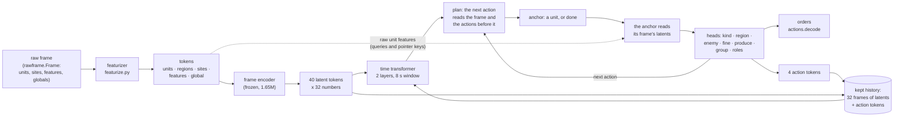
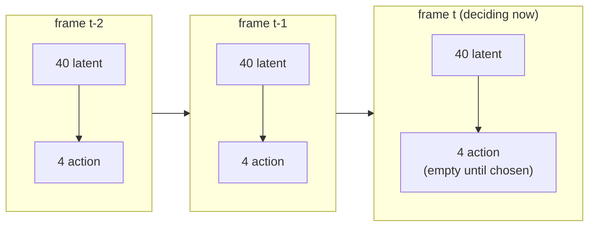
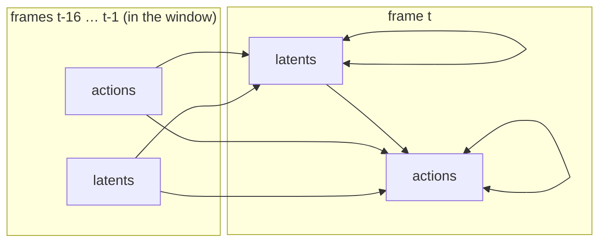
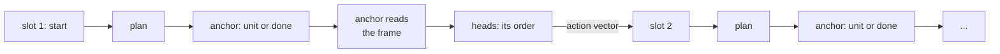
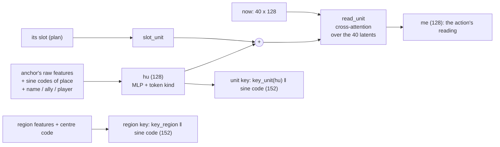
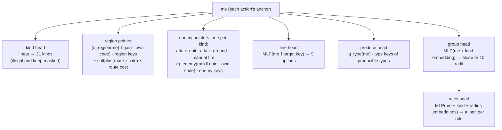
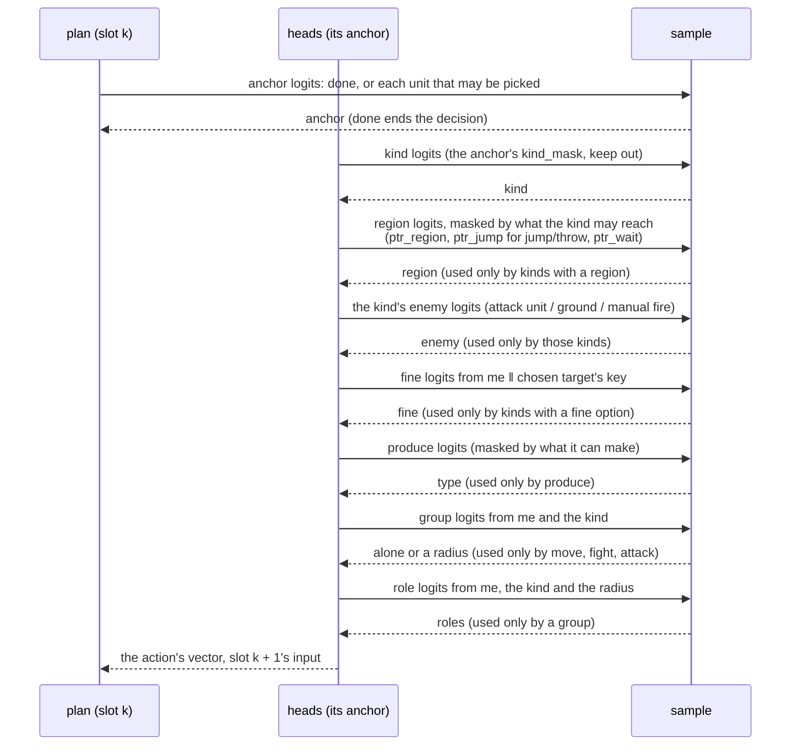
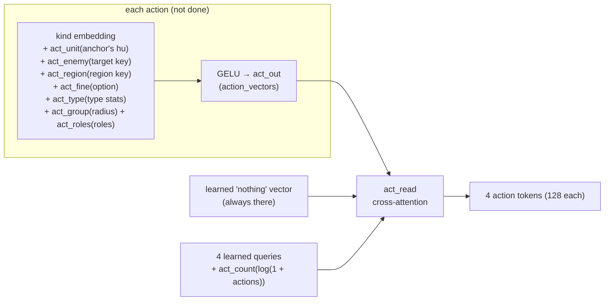
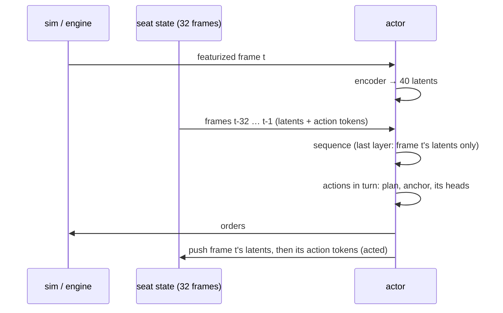
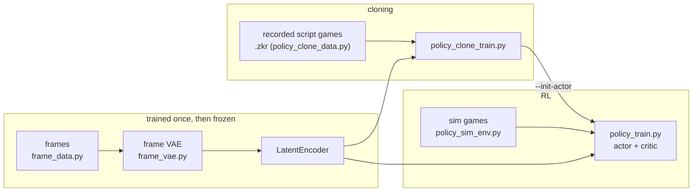

# The policy model

How the learned policy works as of 2026-11-08: what it reads, how it reads it, and how it chooses orders.  The code is
`tools/policy_latent.py` (the actor), `tools/frame_vae.py` and `tools/frame_model.py` (the frozen frame encoder),
`tools/policy_model.py` (batches, sampling, the critic) and `bots/zkbot/policy/featurize.py` (raw frame to tensors).  Results and
the history behind each choice are in `docs/learned-policy/03-training.md` section 11.

## 1. The whole of it

A decision is made every 15 game frames (2 a second).  The seat's raw frame becomes tokens; a frozen encoder squeezes them into 40
latent tokens; the actor reads those latents together with the latents and actions of the frames before, over a sliding window in
time.  It then gives its orders as a player does, one action after another, up to 16, until it chooses done: each action picks a
unit, its anchor, which reads the frame and seven heads choose its order, which may go as a group order to the units about it.
Units no action picks keep what they're doing.  What was done is summarised into 4 action tokens, which later frames read.

| | |
|---|---|
| Width `D` | 128, 4 heads |
| Latent tokens a frame | 40, of 32 numbers each, LayerNormed without weights |
| Action tokens a frame | 4 (`ACTION_TOKENS`) |
| Time layers | 2 (`LAYERS`) |
| Window | 17 frames: 8 s at 2 decisions a second, the frame itself included |
| Reach | 32 frames: each layer reaches 16 further back, so a decision depends on the 32 before it |
| Actions a decision | up to 16 (`actions.SLOTS`), then done |
| Parameters | 1,550,478 trained (the actor, of which 435,737 choose the actions in turn), 1,650,624 frozen (the encoder) |

## 2. What it reads: the featurizer

`featurize.featurize(frame, bundle, table)` turns a raw frame into fixed-normalisation numpy tensors.  Tokens come in a fixed order:

    controllable units | every other unit, most important first | summaries | regions | sites | features | global

* **Units** (up to 592, of which up to 256 controllable, plus 12 summaries of what the caps left out): 127 numbers each. These are
  type stats from the type table, instance state (place, velocity, health, build, flags, ...), the unit's current order and its
  age, 24 terrain rays, and summary counts.  Each unit also has a type name, an alliance and a player, numbered from the viewer.
  Its token kind says what is known of it: seen, blip, memory or summary.
* **Regions** (the map's, about 120 at most): 34 numbers each.  The first 27 are static (place, terrain, spots); the rest say what
  is there now (own value, seen and radar enemy value, DPS, wreck metal, ...).
* **Sites** (metal spots, up to 24): 9 numbers.  **Features** (wrecks in sight, up to 32): 5 numbers.  **Global**: 16 numbers
  (resources, storage, commander, time since contact, ...).
* **Masks for the heads**: which tokens are controllable, which kinds each may choose (`kind_mask`), which enemies each pointer
  kind may aim at, which regions each unit may move, jump or wait to, what each factory may produce, and a route cost to every
  region.
* **Privileged extras for the critic only**: enemy units the seat can't see (`hidden_*`, up to 64).

Names are dropped per game for the actor (`NAME_DROPOUT` 0.3 of the vocabulary becomes "unknown"), so it learns to go by stats
too.  The frozen encoder always sees the true names.

## 3. The frame encoder (frozen)

A Perceiver-style reader, trained on its own as an autoencoder (`frame_vae.py`, run `encoder-big`: width 144, 3 rounds, 40 queries), then frozen: its decoder
is thrown away and the actor keeps `LatentEncoder` (the encoder, `to_mean` and a weightless LayerNorm).

* Cost grows with tokens × 40, not tokens squared: there's no self-attention over the tokens themselves (`token_layers` 0).
* Region tokens carry what their units sum to (`region_pool`, squashed by asinh), since attention averages and can't count.
* What taught the latent: a decoder asked each region what's in it now (value by side and class), the globals, and questions about
  a few units and wrecks per frame ("where is a unit like this?", "what's at this exact place?").  Terrain isn't asked: the actor
  knows the map.  See the docstring of `frame_vae.py` and `03-training.md` 11.5.

## 4. Frames in time: the actor's sequence

The actor lays frames out in order, as GPT-2 lays out text, each frame's 40 latent tokens followed by its 4 action tokens:

* A latent token's input is `latent_in(latents) + slots[i]` (which of the 40 it is).  An action token's is the frame's action
  summary + `act_slots[j]`.
* Frames from before the game began are learned embeddings (`before`, `act_before`), so every decision sees a full reach.

### Who attends to whom

Each `TimeBlock` is a pre-LayerNorm transformer block (attention, then a 4x MLP) with a learned bias on each head by how many
frames back a key is (`age`, 17 values per head), and a learned bias per head for keys that are action tokens (`act_key`).  The
mask is by frame, not by token:

| Query ↓ / key → | latents, earlier frame in window | actions, earlier frame in window | latents, same frame | actions, same frame | any later frame, or out of window |
|---|---|---|---|---|---|
| latent token | yes | yes | yes (all 40, both ways) | **no** | no |
| action token | yes | yes | yes | yes (all 4, both ways) | no |

So within a frame the latents attend to each other in both directions.  They don't see that frame's actions, which are what's
being chosen from them.  The next frame's tokens do see them.  The 4 action tokens of a frame attend to each other in both
directions too.

(Arrows run from key to query: what's read to what reads it.)

With a window of 17 frames and 2 layers, a decision depends on exactly the 32 frames before it (`reach`).  In layer 1, frame t
reads back to t-16 and frame t-16 to t-32.  In layer 2, frame t reads what t-16 took in.  Play keeps those 32 frames (section 7).

The attention is `F.scaled_dot_product_attention` with a dense float mask (age bias + action bias, `-inf` where unseen) of
heads × queries × keys.

## 5. From the sequence to orders: actions, one after another

As Pluto plays StarCraft (2026-11-08): not every unit choosing its own order at once, but a few orders, each to a unit or a group
about it, chosen in turn so that each knows what the ones before it did.  Zero-K's unit AI is made to need little micro, so what
a player does is mostly a few orders to groups.

### Plan: what the next action reads

A small decoder (`plan`, 2 `PlanBlock`s, width 128) runs over the slots: slot 1 is a learned start, and slot k + 1 is the vector of
action k (`action_vectors`, the same vectors the action tokens are made of, section 6), each with a learned embedding of its place
in the list.  In each block a slot attends to the frame's 40 latent tokens (`now`, what the time transformer left for this frame)
and to the slots up to its own, then a 4x MLP.

### The anchor, or done

The slot's output scores every controllable unit, `q_anchor(slot) · key` over the units' keys (section "Pointers" below), and done,
`head_done(slot)`.  A unit may be picked if it may be told something other than keep, and no action before picked it.  Done starts
3 nats up (`DONE_START`), so an untrained actor mostly does nothing.  After done, or 16 actions (`actions.SLOTS`), the decision is
over.

### The anchor reads its frame

The anchor then reads the latents with a cross-attention block (`read_unit`, in `reading`), its query an embedding of its **own raw
features** (`hu`: the same kind of embedding as the encoder's, but the actor's own weights) plus a projection of its slot.  So it
knows exactly where and what it is, whatever the latents blurred, and asks the frame what matters to it for this action.

Every unit token (own or enemy) has a **key**: `key_unit(hu)` followed by the 24-number sine code of its place.  Regions get keys
the same way.  Pointers score against these keys, built from raw features, so a target's exact place is there to choose.

### The heads

What the anchor reads (`me`) goes to the heads, with the anchor's own masks (`policy_model.per_action` takes them out of the batch as
if the actions were units):

* **Kind**: move, fight, attack unit, attack ground, stop, manual fire, jump, cloak on/off, produce, throw, push, pull, place
  beacon, wait at beacon, ... (21 in all; the sim's games enable 14, `policy_sim_env.KINDS`).  Never keep: an action tells its unit
  something, and a unit no action picks keeps.
* **Pointers with place-aware keys**: a pointer's query ends in the anchor's own sine code, each band scaled by a gain it chooses
  (`gain_region`, `gain_enemy`).  Its dot product with a key's sine code is then a sum over bands of gain × cos(band × difference in
  place): a learned function of distance and direction, which a dot product of raw coordinates can't give.
* **Region** also subtracts a learned multiple of the walking cost to each region (`route_bias`), so near regions come first.
* **Fine** (9 options): option 0 is the target itself; options 1-8 are the compass points around it.  For a region, these are at
  half its equivalent radius, with north towards the enemy; for attack ground, they are 200 elmos from the enemy target.  It reads
  the chosen target's key, so it's chosen after the target.
* **Produce**: a factory's or silo's choice among producible types, scored against embeddings of their stats.
* **Group** (move, fight and attack only): alone, or as a group order of one of 10 radii, 60 to 2,250 elmos
  (`bots/zkbot/policy/groups.py`): the sim then gives the order as well to every unit of the side of the chosen roles within that
  radius of the anchor.  It starts at alone (`ALONE_START`).
* **Roles** (a group only): each of the 15 roles with a mobile type in or out, a Bernoulli each, given the radius.

### Sampling, in order

An action's log-probability is its anchor's (or done's) plus the heads its kind uses; a decision's is the sum over its actions.
Sampling is Gumbel-max.  `actions.to_decision` makes the actions what each unit was told, and `actions.decode` orders for the sim or
the engine.  In training all the slots are scored in one pass (`evaluate_actions`): the decoder is causal over them, so each scores
as when it was chosen.

`policy_model.each_unit_heads` gives the heads for every unit as if it were the first action's anchor, to look at what the policy
makes of each unit.

## 6. Action tokens: what was done

What was done at a frame becomes that frame's 4 action tokens (`action_tokens`).  Only the policy's own choices go in:
the economy script's and the opening's orders show only in later frames, as each unit's current order.

However many actions there were (0 to 16; in cloning, every order the script gave), the frame's actions are summarised into 4
tokens; a frame where the policy was done at once still has 4 tokens, which read only "nothing" and the count.  They are a
fixed-size, unordered summary.  The same action vectors are what the decoder reads of the actions before (section 5).

## 7. Play and training

### In play: one decision at a time

A seat keeps the 32 frames before the present, newest first: each frame's raw latents (40 × 32) and its 4 action tokens, flat
(`record` numbers a frame).  `decide` runs the encoder on the new frame, lays out the 33 frames, and runs the sequence.  The first
layer runs over every token.  The last runs only the newest frame's latent tokens as queries (`newest_only`).  The actions are then
chosen in turn (`policy_model.sample_actions`), and `acted` writes their tokens into the newest frame's slot.

### In training: a stretch in one pass

Training takes a stretch of decisions with the 32 frames before it and runs the whole sequence at once.  Because the mask is
causal by frame, every decision in the stretch sees exactly what it would have seen in play.

* **Cloning** (`policy_clone_train.py`): stretches of 48 decisions from recorded script games (`policy_clone_data.py`).  The
  script's orders become the labels (`actions.encode`), then actions in a random order, at most 16 (`actions.to_slots`), and the
  action tokens are built from all of them.  The loss is the negative log-probability of each action, done included.  The script's
  orders have no order of their own, so an action's anchor scores as any unit the script told something and no action before it
  picked (`evaluate_actions`' `labelled`).  By default only decisions where the script looked count (every 6th).
* **PPO** (`policy_train.py`): segments of 32 decisions from the sim, each started from the state kept at collection.  Each action
  gets its own clipped ratio, averaged within a decision (done included), with one advantage per decision.  The **critic** is a separate network,
  never in the bot.  It is a 2-layer self-attention encoder over the privileged frame, including the enemy units the seat can't
  see, and reads the value off its global token.

## 8. Where it stands

* Cloning on `army-3` (11.9) was still learning after 3,000 steps.  An act's kind was right about a quarter of the time, with no
  measurable difference with or without action tokens.  That was the form where every unit chose; actions in turn
  (`03-training.md` 11.18) haven't been cloned beyond a smoke test.
* Nothing plays in the engine yet.  The bot (`bots/zkbot`) hosts the policy but sends no commands, until a numpy forward of the
  actor and encoder, and the opening and economy script, are there.
* Open questions, from the user:
  * full attention over all past frames through summary tokens, in place of the 8 s window;
  * FlexAttention, with one token per acting unit and causal attention along them in place of the 4 summary tokens.  Within a
    decision the actions now are such tokens (the decoder); between frames they're still the 4 summary tokens.
